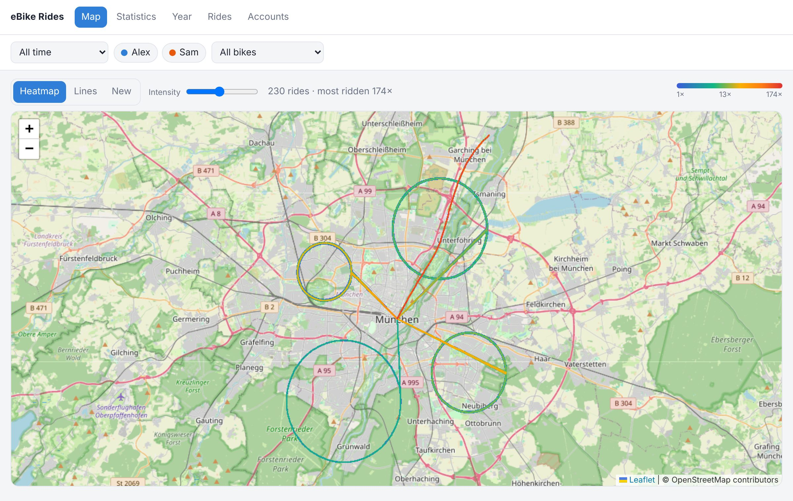
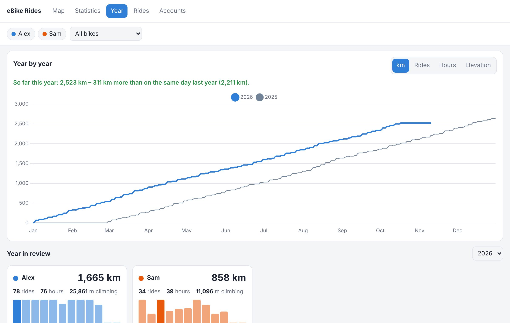
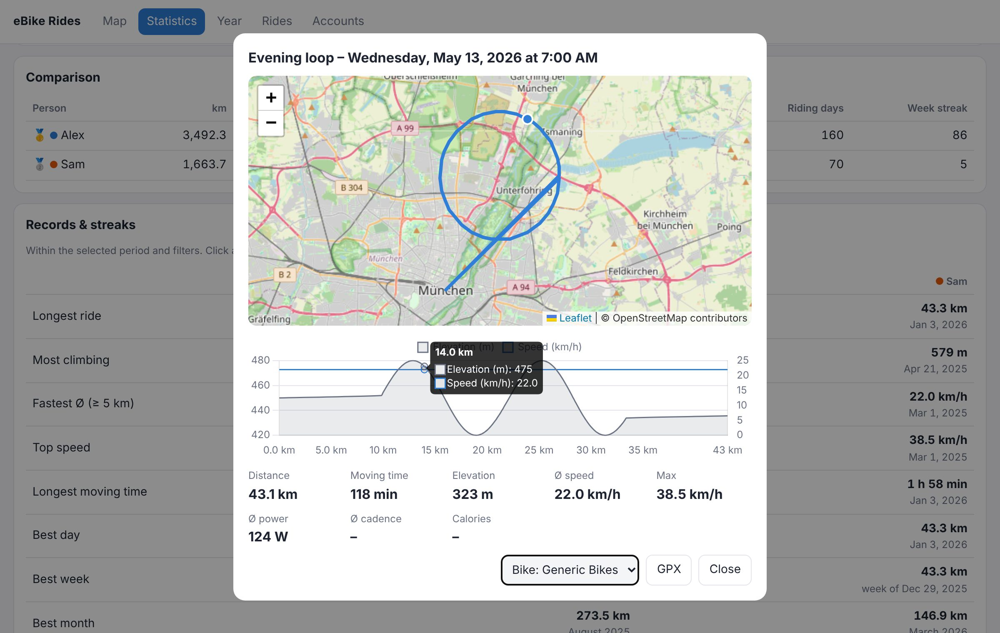
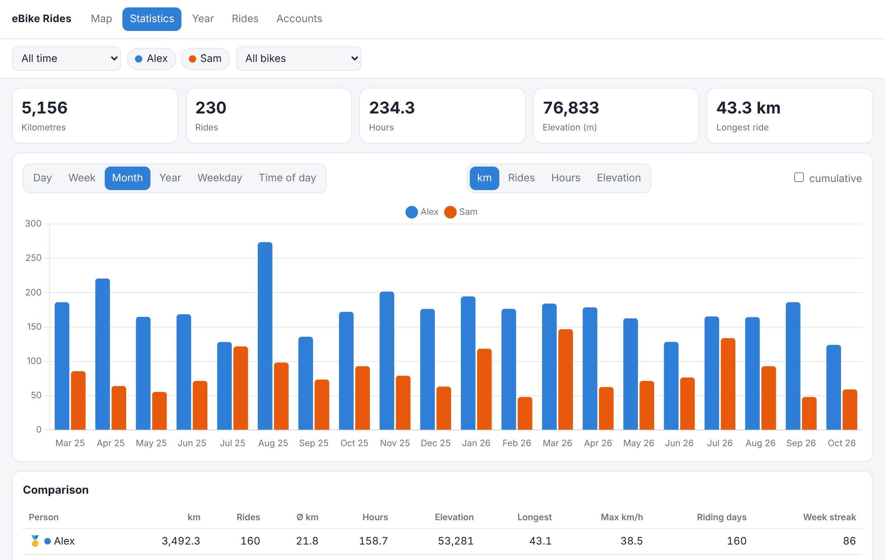
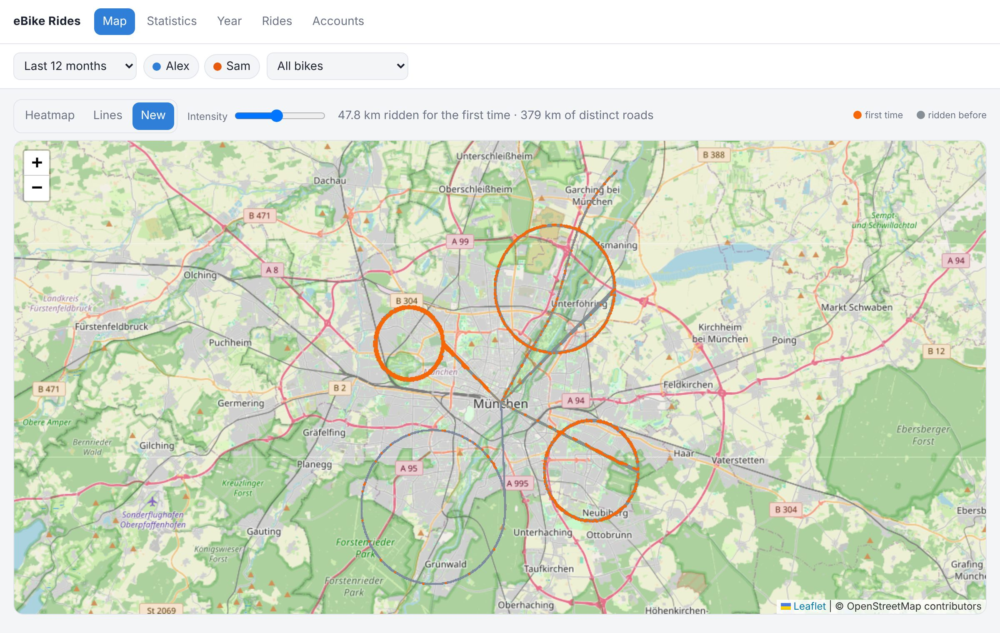

# eBike Rides for Home Assistant


All Bosch eBike Flow (Smart System) rides of your whole family in one place – a heatmap of the ways you ride most, records and year-by-year comparison per person, GPX export – stored on your Home Assistant, not just in the cloud.

[](https://my.home-assistant.io/redirect/supervisor_add_addon_repository/?repository_url=https%3A%2F%2Fgithub.com%2Fblumentarzan%2Fha-bosch-ebike-rides)



## Features

- **Several Bosch accounts** – one per person, each with its own colour; every view can show everyone or only some.
- **Heatmap** – counts *rides* per ~25 m stretch, not GPS points, so a traffic light does not become a hotspot. Or all rides as **lines**.
- **New roads** – what you rode for the first time in a period, plus km of distinct roads.
- **Statistics** – km, rides, hours, climbing per day, week, month, year, weekday or time of day; leaderboard; **records & streaks** (longest ride, most climbing, best week, longest day and week streak, …).
- **Year tab** – every year as a cumulative curve, “so far this year vs. the same day last year”, and a year in review per person.
- **Ride details** – map, elevation and speed profile linked by hover, power, cadence, calories, GPX.
- **Export** – any ride as GPX, or all (filtered) rides as a ZIP.
- **Home Assistant sensors** – km this year / month / week, rides this year, days since last ride, last ride, battery (when reported) per person, and an event for every new ride.
- **Your data stays** – rides and GPS tracks are stored in the add-on (and in every HA backup), so nothing is lost if the Bosch cloud changes.
- English and German, following your Home Assistant language.

| Year in review | Ride details |
|---|---|
|  |  |
| **Statistics** | **New roads** |
|  |  |

<sub>Screenshots use generated demo rides.</sub>

## Install

Needs Home Assistant OS or a Supervised installation (apps/add-ons are not available on Container or Core installs). amd64 and aarch64.

1. Click the **Add repository** button above – or in Home Assistant go to **Settings → Apps** (called *Add-ons* before HA 2026.2), open the store, then ⋮ → **Repositories** and add
   `https://github.com/blumentarzan/ha-bosch-ebike-rides`.
2. Install **eBike Rides**, start it and open it from the sidebar.
3. **Accounts** tab: add one Bosch account per person and log in.

The first sync loads all rides and then every GPS track; with a few hundred rides that takes a few minutes. Updates show up in Home Assistant like any other update.

### Logging in

The add-on uses the same login as the eBike Flow app. At the end Bosch hands the login to the app (`onebikeapp-ios://…`), which a browser cannot open, so on a computer you copy that last step from the browser's developer tools: in Chrome or Edge it is one red line in the *Console* tab, which you paste into the add-on. The dialog walks you through it and checks what you pasted. You only do this once per person – afterwards the add-on renews access by itself.

EU accounts can alternatively use Bosch's official **EU Data Act** interface with their own client ID.

Details, options and troubleshooting: [ebike_rides/DOCS.md](ebike_rides/DOCS.md).

## How it works

```
Bosch cloud ──(per account: Flow-app API or EU Data Act API)──► sync ──► SQLite (/data)
                                                                          │
           Ingress web UI (map, statistics, year, rides, accounts) ◄──────┤
           HA sensors + ebike_rides_new_activity event ◄──────────────────┘
```

- `ebike_rides/app/bosch/` – OAuth (PKCE) and both API clients, normalised to one model.
- `ebike_rides/app/sync.py` – backfill of all rides and tracks, then incremental sync.
- `ebike_rides/app/attribution.py` – which bike a ride was on (bike id → odometer → single bike).
- `ebike_rides/app/geo.py` – track simplification and the ~25 m grid used by the heatmap and the explorer.
- `ebike_rides/app/stats.py`, `insights.py` – statistics, records, streaks, year curves and review.
- `scripts/upstream_watch.py` + workflow – daily check of the projects that document the Bosch API; opens an issue when endpoints or auth change there.

## Development

```
pip install -r ebike_rides/requirements.txt pytest pytest-asyncio
python -m pytest            # runs against a fake Bosch cloud (tests/fake_bosch.py)
python scripts/preview.py   # UI with generated demo rides on http://localhost:8099
```

## Credits

The Bosch endpoints and login flow were learned from [partymola/bosch-flow-mcp](https://github.com/partymola/bosch-flow-mcp) and [Xunil99/ha-bosch-ebike](https://github.com/Xunil99/ha-bosch-ebike) – thank you. No code is copied from them. Bundled: [Leaflet](https://leafletjs.com) and [Chart.js](https://www.chartjs.org) (licenses in `ebike_rides/app/static/vendor`). Map tiles © [OpenStreetMap](https://www.openstreetmap.org/copyright) contributors.

Unofficial project, not affiliated with or endorsed by Bosch. “Bosch” and “eBike Flow” are trademarks of their owners. The Flow app login uses the app's own interface and may change without notice.

License: MIT
